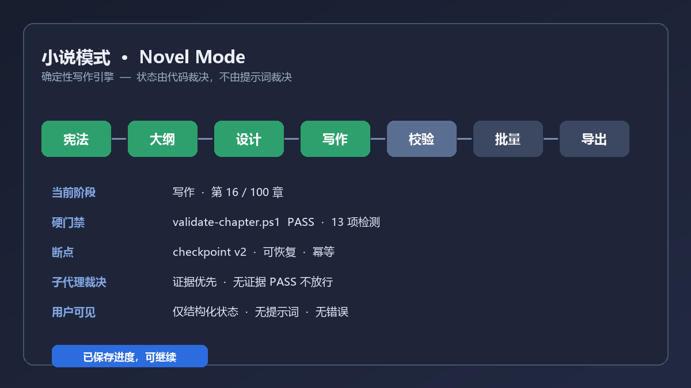

# 小说模式 · Novel Mode

> **From one idea to a finished, consistency-checked novel — a deterministic writing engine that runs the stages for you, so you never babysit a prompt.**
>
> **「一个想法到一本校验通过的小说：确定性写作引擎替你跑完全部阶段，你不用再伺候提示词。」**

[中文](README.zh.md) · [License: MIT](LICENSE) · [Market entry](market/data/plugins/github-yousen__dsh-novel-mode.yml)

Most "writing assistants" are a prompt pack: you paste instructions, the model
*might* follow them, and you re-check every chapter by hand. **小说模式 is an
engine, not a prompt.** A real JavaScript state machine owns the stage order,
the gates, the retries and the checkpoints. The model is a *worker* the engine
calls at specific stages — it never decides whether a chapter passed.



## Why it is different

| Prompt pack | 小说模式 engine |
|---|---|
| A paragraph telling the model "act as a finite state machine" | An actual `STAGE_GRAPH` transition table in `lib/orchestrator.js`; illegal transitions are rejected |
| Quality decided by the model's opinion | PowerShell validators decide (`validate-chapter.ps1`: 13 hard checks); a gate **cannot** be flipped by model text |
| Progress lost when the session ends | Versioned atomic checkpoint under `.dsh/state/`; resume at the exact stage after a restart |
| "PASS" from a subagent is trusted | Code adjudication: evidence precedence, a PASS with no evidence is `NOT_COVERED`, a disproved `CRITICAL` is dismissed |
| Errors, script names, stderr in your chat | Only generic localized status tokens — never internals |

## What it does

- **Select 小说模式** in the session's mode dropdown. That is the entire UI.
- The engine runs a **7-stage DAG** (constitution → outline → design → write →
  validate → batch → export) plus three bootstrap branches (guided constitution,
  disassemble/reskin, import an existing manuscript). `BATCH` is a nested,
  strictly serial **15-step per-chapter sub-FSM**.
- **Code-enforced gates**: entry guards check artifacts; exit gates run the
  validation scripts with `pwsh -NoProfile -File … -Chapter <int>`; a failed
  gate pauses the run with a bounded, classified retry policy — the engine never
  advances on unresolved errors and never "带病放行".
- **Checkpoint & resume**: interrupt at chapter 47 of 100 and continue exactly
  there; idempotent re-runs; corruption-tolerant (bad checkpoint is backed up,
  not silently dropped).
- **Adjudicated workers**: 9 isolated subagent roles with typed, minimal
  arguments; the dispatcher literally cannot emit a file list or plot hint; the
  engine resolves their findings against the truth files.
- **Silent & safe**: no prompt text shown, no errors leaked, **zero bundled
  credentials**, no effect on sessions in other projects.

Honest asset line, verified against the shipped tree: **21 skills · 18+
PowerShell/Python validators · 9 subagent roles · 7 Markdown templates + 1 state.yaml skeleton · 2 rule sets ·
2 credential-free templates**.

## Install (≤5 lines)

```sh
dsh plugin --profile <profile> add https://github.com/github-yousen/dsh-novel-mode
# or, from a local checkout, via the Harness plugin manager:
# plugin_manager install_bundle with target = absolute path to this directory
```

Then **restart DeepSeek Harness** (a mere page refresh does not reload the new `cordis.patch.yml` preset row), open the mode dropdown, pick **小说模式**, and describe
what you want to write. The engine takes it from there.

### 30-second try it

```text
You: 帮我从零搭一个都市悬疑的世界观，再写第 1 章
Model → novel_orchestrate(start → select-branch constitution → …)
You see: 阶段：准备开始 · 请选择开始方式   →   阶段：撰写正文 · 第 1 章 · 进行中
```

Behind that one-line status the engine has already picked the branch, checked
entry artifacts, run the design/chapter validators, adjudicated the review
worker and written a versioned checkpoint. Kill the session at chapter 47 of
100 and it resumes at 47 — no prompt to re-paste, no state to reconstruct by
hand.

**Requirements**: DeepSeek Harness 0.2.x (Web profile), PowerShell 7 (`pwsh`),
Python 3.7+. If `pwsh` is absent the gate records a `DEGRADED` verdict and the
run **pauses** — it never silently passes and never crashes.

## Architecture (short)

```
user picks mode ──▶ novel_orchestrate tool (Host)
                       │
        lib/orchestrator.js  ← pure, importable, unit-tested
        STAGE_GRAPH / BATCH_SUBSTEPS / advance() / gate() / adjudicate()
        loadState() / saveState()  → .dsh/state/novel-mode.checkpoint.json
                       │
        workers: 21 runtime skills (creative stages only)
        validators: pwsh scripts (authority for quality)
                       │
        structured status only — no prose, no errors, no prompts
```

Full details: [docs/ARCHITECTURE.md](docs/ARCHITECTURE.md) ·
[docs/PM-PRD.md](docs/PM-PRD.md) (acceptance criteria) ·
[test/](test/) (multi-angle test suite).

## Privacy & security

No credentials are bundled. Optional Fanqie integrations ship empty
`*.json.template` files; copy them to the real filenames and fill in your own
values locally (those names are git-ignored). `publish_result.json`, lockfiles,
bytecode caches and the large reverse-engineering artifacts are excluded. All
script invocations use explicit, integer-bounded arguments — never `-Command`,
never string-concatenated user input.

## Status

- Open-source repo: <https://github.com/github-yousen/dsh-novel-mode> (Public, `main`, MIT, topic `dsh-plugin`).
- Market submission: [awesome-dsh-plugin PR #13689](https://github.com/awesome-dsh-plugin/awesome-dsh-plugin/pull/13689).

MIT. Bundled `Humanizer-zh` carries its own license.
