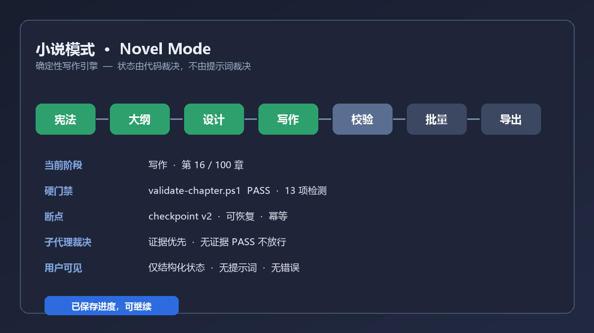

# 小说模式 · Novel Mode

> **「一个想法到一本校验通过的小说：确定性写作引擎替你跑完全部阶段，你不用再伺候提示词。」**
>
> *From one idea to a finished, consistency-checked novel — a deterministic writing engine that runs the stages for you, so you never babysit a prompt.*

[English](README.md) · [MIT 许可](LICENSE) · [市场条目](market/data/plugins/github-yousen__dsh-novel-mode.yml)

市面上多数「写作助手」本质是一包提示词：你把指令贴进去，模型*可能*照做，
每章还得自己复核。**小说模式是引擎，不是提示词。** 一段真实的 JavaScript
状态机掌握阶段顺序、门禁、重试与断点；模型只是引擎在特定阶段调用的
**工人**，永远无权决定「这一章过没过」。



## 到底有什么不同

| 提示词包 | 小说模式引擎 |
|---|---|
| 一段话告诉模型「你现在是有限状态机」 | `lib/orchestrator.js` 里真实的 `STAGE_GRAPH` 转移表，非法转移直接拒绝 |
| 质量由模型自己说了算 | PowerShell 校验脚本裁决（`validate-chapter.ps1` 13 项硬检测）；模型文本**无法**翻转门禁 |
| 会话一断进度就没了 | `.dsh/state/` 下版本化原子断点；重启后精确恢复到中断处 |
| 子代理报个 PASS 就信 | 代码裁决：证据优先序，无证据的 PASS 判 `NOT_COVERED`，被事实驳回的 CRITICAL 作废 |
| 报错、脚本名、stderr 直接甩到聊天里 | 只有通用的本地化状态词，绝不暴露内部细节 |

## 它做什么

- 在会话的**模式下拉框**里选「小说模式」——整个 UI 就这一下。
- 引擎跑一个 **7 阶段 DAG**（宪法 → 大纲 → 设计 → 写作 → 校验 → 批量 → 导出），
  外加三条 bootstrap 分支（引导建宪法 / 拆书换皮 / 导入已有书稿）。
  `BATCH` 是嵌套的、严格串行的 **15 步单章子状态机**。
- **代码硬门禁**：入口门检查产物；出口门以
  `pwsh -NoProfile -File … -Chapter <整数>` 跑校验脚本；失败的门按有界、分类的
  重试策略暂停——引擎绝不在 unresolved 错误上放行，绝不「带病通过」。
- **断点与恢复**：100 章写到第 47 章中断，就从第 47 章继续；重跑幂等；
  断点损坏会先备份再重建，绝不静默丢弃。
- **经裁决的工人**：9 个隔离子代理角色，参数类型化且最小化；派发器在代码
  层面无法输出文件清单或剧情提示；引擎按事实文件裁决它们的结论。
- **安静且安全**：不展示提示词、不外泄错误、**零内置凭据**、不影响其它项目会话。

可复核的量化（对最终发布树重新清点）：**21 个技能 · 18+ 个
PowerShell/Python 校验脚本 · 9 个子代理角色 · 7 个 Markdown 模板 + 1 份 state.yaml 骨架 · 2 套规则 ·
2 个空值凭据模板**。

## 安装（不超过 5 行）

```sh
dsh plugin --profile <profile> add https://github.com/github-yousen/dsh-novel-mode
# 或从本地检出目录：Harness 插件管理器 plugin_manager install_bundle，
# target 填本目录绝对路径
```

然后**刷新页面**，打开模式下拉框选「小说模式」，说出你想写什么，剩下的交给引擎。

### 30 秒上手

```text
你：帮我从零搭一个都市悬疑的世界观，再写第 1 章
模型 → novel_orchestrate(start → select-branch constitution → …)
你只会看到：阶段：constitution · 就绪   →   阶段：write · 第 1 章 · 就绪
```

这一行状态背后，引擎已经选好分支、检查入口产物、跑过设计稿/正文校验脚本、
按证据裁决了评审子代理、写好版本化断点。100 章写到第 47 章时关掉会话，
回来仍从第 47 章继续——不用重贴提示词，不用手工重建状态。

**运行要求**：DeepSeek Harness 0.2.x（Web profile）、PowerShell 7（`pwsh`）、
Python 3.7+。若缺少 `pwsh`，门禁会记为 `DEGRADED` 并**暂停**运行——
绝不静默放行，也绝不崩溃。

## 架构速览

```
用户选模式 ──▶ novel_orchestrate 工具（Host）
                    │
      lib/orchestrator.js  ← 纯函数、可独立导入、有单元测试
      STAGE_GRAPH / BATCH_SUBSTEPS / advance() / gate() / adjudicate()
      loadState() / saveState() → .dsh/state/novel-mode.checkpoint.json
                    │
      工人：21 个运行时技能（仅承担创作阶段）
      校验器：pwsh 脚本（质量的唯一裁判）
                    │
      只输出结构化状态 —— 无散文、无错误、无提示词
```

详见 [docs/ARCHITECTURE.md](docs/ARCHITECTURE.md) ·
[docs/PM-PRD.md](docs/PM-PRD.md)（验收清单）· [test/](test/)（多角度测试套件）。

## 隐私与安全

不内置任何凭据。可选的番茄站点集成只提供空的 `*.json.template`；需要时复制到
真实文件名并在本地填写（这些文件名已被 git 忽略）。`publish_result.json`、
lockfile、字节码缓存与体积庞大的逆向分析文件均已剔除。所有脚本调用都使用
显式、整数有界的参数——绝不用 `-Command`，绝不拼接用户输入。

## 状态

- 开源仓库：<https://github.com/github-yousen/dsh-novel-mode>（Public、`main`、MIT、topic `dsh-plugin`）。
- 市场投稿：[awesome-dsh-plugin PR #13689](https://github.com/awesome-dsh-plugin/awesome-dsh-plugin/pull/13689)。

MIT。随包的 `Humanizer-zh` 使用其自带许可证。
